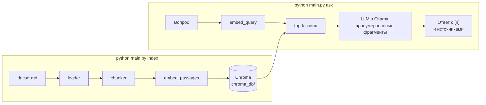

# rag-from-scratch

[](https://github.com/ZhdankovAlex/rag-from-scratch/actions/workflows/tests.yml)

RAG-ассистент по технической документации, собранный с нуля: от загрузки Markdown
до ответа LLM со ссылками на источники. Демо-корпус — 44 страницы русской
документации [FastAPI](https://github.com/fastapi/fastapi) (637 чанков).

Пайплайн написан без RAG-фреймворков — каждый шаг (чанкинг, эмбеддинги, поиск,
сборка контекста, цитирование) реализован явно и запускается отдельно. Всё работает
локально и бесплатно: эмбеддинги — `sentence-transformers` на CPU, ответы —
локальная LLM через [Ollama](https://ollama.com), документы никуда не отправляются.
Документация не зашита в код: подойдёт любая папка с Markdown.

## Как это работает



| Модуль | Ответственность |
|---|---|
| [`rag_system/loader.py`](rag_system/loader.py) | Рекурсивно читает `.md` из `docs/`. Пути считаются от корня проекта, поэтому запуск не зависит от текущей папки. |
| [`rag_system/chunker.py`](rag_system/chunker.py) | Режет документ по заголовкам `##` (строки внутри блоков кода не считаются заголовками); каждому чанку добавляется путь `Документ > Раздел`, название документа берётся из `#` или `<h1>`. Вводный текст до первого `##` — отдельный чанк. Эмбеддинг строится по `Документ > Раздел` + текст, хранится и цитируется только текст. Разделы длиннее 1000 символов дорезаются `RecursiveCharacterTextSplitter` с перекрытием 200. ID чанка стабилен: `файл::раздел::часть`. |
| [`rag_system/embeddings.py`](rag_system/embeddings.py) | Эмбеддинги `intfloat/multilingual-e5-small` (384 измерения, локально на CPU). Префиксы `query:` / `passage:`, нормализация векторов, батчевое кодирование. |
| [`rag_system/vector_store.py`](rag_system/vector_store.py) | ChromaDB с косинусной метрикой. `sync_chunks()` инкрементальная: у каждой записи хранится отпечаток (модель + префикс + заголовок + текст), эмбеддинги считаются только для новых и изменившихся чанков, upsert по ID, чанки, которых больше нет в документации, удаляются. |
| [`rag_system/index.py`](rag_system/index.py), [`rag_system/retriever.py`](rag_system/retriever.py) | Та же схема поиска без БД: индекс в памяти и top-k на NumPy. Нужны для понимания механики и сравнения с Chroma. |
| [`rag_system/ollama_chat.py`](rag_system/ollama_chat.py) | Генерация ответа локальной моделью через Ollama: чанки передаются пронумерованными, модель ставит `[n]` после утверждений, маркеры разбираются и перенумеровываются, ответ возвращается со списком источников. |
| [`rag_system/answer.py`](rag_system/answer.py) | Типы ответа (`Answer`, `Source`) и признак ответа без опоры на источники. |
| [`rag_system/evaluate.py`](rag_system/evaluate.py) | Оценка поиска: hit@k и MRR по набору вопросов с ожидаемыми файлами. |
| [`rag_system/cli.py`](rag_system/cli.py) | CLI: `index`, `search`, `ask`, `chat`, `eval`. Запуск — `python main.py …` или `python -m rag_system …`. |
| [`scripts/prepare_corpus.py`](scripts/prepare_corpus.py) | Собирает `docs/` из клона репозитория FastAPI (см. «Документы в базе»). |
| [`scripts/compare_embeddings.py`](scripts/compare_embeddings.py) | Сравнивает варианты эмбеддингов на наборе вопросов и пишет `eval/experiments.json`. |
| [`web/`](web/) | Локальный веб-интерфейс: FastAPI + Jinja2 + чистый JS, JSON API с описанием в Swagger. |

### Генерация ответа

- Модель по умолчанию — `qwen2.5:7b` в Ollama, `temperature 0.1`, окно контекста
  8192 токена (по умолчанию Ollama молча обрезает длинный промпт).
- Найденные чанки передаются пронумерованными фрагментами `[1]…[5]` с файлом
  и разделом. Системный промпт разрешает отвечать только по ним и ставить номер
  фрагмента после каждого утверждения.
- Маркеры из ответа перенумеровываются в порядке первого упоминания, `[1, 3]`
  понимается, выдуманные номера (вне переданных фрагментов) выбрасываются.
  Под ответом — файл и раздел каждого источника.
- Если ответа во фрагментах нет, модель отвечает ровно «В найденной документации
  нет ответа на этот вопрос.» и не дополняет общими знаниями.
- Если ответ не ссылается ни на один источник (и это не отказ), CLI
  предупреждает: такой ответ мог прийти из общих знаний модели.

Качество ответов пока проверяется вручную: на CPU (16 ГБ RAM, без видеокарты)
ответ `qwen2.5:7b` идёт около минуты. Автоматическая оценка ответов — в
[ROADMAP](ROADMAP.md).

## Быстрый старт

Нужны Python 3.10+ и [Ollama](https://ollama.com/download).

```bash
ollama pull qwen2.5:7b          # ~4.7 ГБ; на слабой машине — qwen2.5:3b (~2 ГБ)

python -m venv .venv
.venv\Scripts\activate          # Linux/macOS: source .venv/bin/activate
pip install -r requirements.txt

copy .env.example .env          # Linux/macOS: cp .env.example .env

python main.py index            # первый запуск скачает модель эмбеддингов (~470 МБ)
python main.py ask "Как разрешить запросы к API с фронтенда на другом домене?"
```

Настройки в `.env`: `OLLAMA_MODEL` (по умолчанию `qwen2.5:7b`) и `OLLAMA_URL`
(по умолчанию `http://localhost:11434`). Модели можно хранить не на системном
диске: переменные окружения `OLLAMA_MODELS` (Ollama) и `HF_HOME` (эмбеддинги).

## Веб-интерфейс

```bash
python -m web                    # откроет http://127.0.0.1:8770/, API — /docs
```

| Страница | Что там |
|---|---|
| **Спросить** | Вопрос модели. Сразу показываются найденные фрагменты со шкалой сходства, через ~минуту — ответ с маркерами `[n]`. Клик по маркеру подсвечивает фрагмент, на который он ссылается; ответ без ссылок помечается предупреждением. |
| **Поиск** | Только поиск, без LLM и без Ollama: ближайшие фрагменты, их сходство, время запроса. Удобно разбираться, почему ответ получился таким. |
| **Качество** | Метрики `eval` (hit@k, MRR по dev и test), распределение рангов, сравнение моделей эмбеддингов и таблица всех вопросов с фильтром промахов. |
| **Документы** | Что лежит в базе: документы и число фрагментов в каждом, распределение длин фрагментов, кнопка переиндексации. |

Внизу боковой панели — состояние индекса и Ollama (запущена ли, скачана ли модель).
Сервер слушает только `127.0.0.1`.

## Команды

| Команда | Что делает | Нужна запущенная Ollama |
|---|---|---|
| `python main.py index` | Загружает `docs/`, режет на чанки и синхронизирует Chroma: первый раз ~1 мин на CPU, дальше пересчитываются только изменения (без изменений — доли секунды) | нет |
| `python main.py search "запрос" [-k N]` | Показывает найденные чанки и их сходство — для отладки поиска | нет |
| `python main.py ask "вопрос" [-k N]` | Ответ на один вопрос с источниками | да |
| `python main.py chat [-k N]` | Вопросы в цикле; пустая строка или Ctrl+C — выход | да |
| `python main.py eval [-v] [-s dev\|test]` | Метрики поиска на наборе вопросов, отдельно для dev и test (см. ниже) | нет |

`-k` — сколько чанков искать (по умолчанию 5).
Каждый модуль пакета `rag_system/` можно запустить и сам по себе
(`python -m rag_system.retriever`) — внизу файла есть демо.

Пример вывода `search` (текст чанков сокращён):

```text
> python main.py search "Как разрешить запросы к API с фронтенда на другом домене?" -k 3
1. [0.885] cors.md — CORS (Cross-Origin Resource Sharing) > Шаги
2. [0.881] security-first-steps.md — Безопасность — первые шаги
3. [0.875] security-first-steps.md — Безопасность — первые шаги > «`password` flow» (аутентификация по паролю)
```

## Документы в базе

`docs/` — 44 страницы из `docs/ru/docs` репозитория
[fastapi/fastapi](https://github.com/fastapi/fastapi) (© Sebastián Ramírez,
лицензия MIT, текст лицензии — [`docs/LICENSE`](docs/LICENSE)): учебник, зависимости,
безопасность, настройки, развёртывание. Взяты страницы с полноценным текстом,
файлы переименованы в плоский список с уникальными именами.

[`scripts/prepare_corpus.py`](scripts/prepare_corpus.py) воспроизводит корпус из
клона FastAPI и убирает разметку, которая имеет смысл только на сайте FastAPI:
якоря заголовков `{ #… }`, директивы подключения кода `{* … *}` (сами примеры кода
лежат в `docs_src/` и в корпус не входят) и рамки блоков `/// tip`.

```bash
git clone --depth 1 --filter=blob:none --sparse https://github.com/fastapi/fastapi.git
git -C fastapi sparse-checkout set docs/ru
python scripts/prepare_corpus.py fastapi
```

## Тесты

```bash
pip install -r requirements-dev.txt
python -m pytest
ruff check .                     # линтер, правила в pyproject.toml
```

Тесты работают офлайн и за секунды: модель эмбеддингов заменена детерминированными
векторами (фикстура падает, если тест попытается загрузить настоящую), Chroma
пишется во временную папку, ответы LLM подменяются заранее собранными.
Покрыты чанкинг, синхронизация хранилища (повтор, обновление, удаление, батчи,
инкрементальность), сборка промпта и разбор маркеров `[n]`, ошибки Ollama,
CLI (вызов Ollama, предупреждение об ответах без источников), веб-API (поиск, ответ, ошибки Ollama), метрики `eval`
и согласованность набора вопросов с корпусом.

Линтер и тесты запускаются на каждый push в GitHub Actions
([`.github/workflows/tests.yml`](.github/workflows/tests.yml)) — с CPU-сборкой torch
и в офлайн-режиме Hugging Face, так что случайная загрузка модели уронит прогон.

## Качество поиска

```bash
python main.py eval            # сводка по dev и test
python main.py eval -v -s test # по каждому вопросу test-части
```

Набор [`eval/retrieval_questions.json`](eval/retrieval_questions.json) — 54 вопроса,
сформулированных так, как спросил бы пользователь (не копией заголовков). Для каждого
указаны файлы, где ответ есть в тексте; попадание считается по файлу первого
релевантного чанка. Метрики: **hit@k** — доля вопросов, где нужный файл есть
в top-k; **MRR** — средний обратный ранг первого попадания (глубина поиска 20).

- **dev** (24 вопроса) — на них сравниваются варианты поиска, поэтому их цифры
  оптимистичны.
- **test** (24 вопроса; каждый из 44 документов покрыт dev или test) — отложенная
  часть, в выборе настроек не участвует.
- **отрицательные** (6 вопросов в test: Kafka, Prometheus, gRPC, Stripe…) — ответа
  в корпусе нет, проверено поиском по тексту. В метриках поиска не участвуют, нужны
  для проверки, что модель отказывается отвечать.

| Часть | hit@1 | hit@3 | hit@5 | MRR |
|---|---|---|---|---|
| dev | 83% | 92% | 96% | 0.876 |
| test | 79% | **100%** | **100%** | 0.889 |

Нужный документ почти всегда в top-3, промахи на первом месте — соседние страницы
одной темы: «Как получить имя пользователя и пароль из формы при выдаче токена?»
находит сначала `security-first-steps.md`, а ответ подробно разобран
в `simple-oauth2.md`.

### Что влияет на качество

Сравнение вариантов на этом корпусе (те же чанки, поиск в памяти; воспроизводится
`python scripts/compare_embeddings.py`, ~4 мин на CPU):

| Вариант | dev hit@1 | dev MRR | test hit@1 | test MRR |
|---|---|---|---|---|
| `BAAI/bge-small-en-v1.5` (англоязычная модель) | 29% | 0.443 | 46% | 0.539 |
| `multilingual-e5-small`, только текст чанка | 71% | 0.805 | 83% | 0.899 |
| + заголовок `Документ > Раздел` в тексте для эмбеддинга, без префиксов E5 | 79% | 0.867 | 83% | **0.917** |
| + префиксы `query:` / `passage:` (текущий) | **83%** | **0.876** | 79% | 0.889 |

- **Модель эмбеддингов** — главный фактор: мультиязычная модель того же размера
  вдвое точнее англоязычной на русском корпусе.
- **Заголовок в эмбеддинге** поднимает dev (MRR +0.06): части длинного раздела
  и вводные абзацы не содержат названия темы, пока его не добавить. На test
  разница в пределах одного вопроса.
- **Префиксы E5** — тоже в пределах одного вопроса из 24 в обе стороны; оставлены,
  потому что модель обучалась с ними.

На наборе из 24 вопросов один вопрос — это 4 п.п. hit@1 и до 0.04 MRR, поэтому
различия меньше этого — шум.

**Проверено и не взято (на другом, закрытом корпусе того же размера):** гибридный
поиск BM25 + векторы с Reciprocal Rank Fusion (четыре варианта токенизации
русского, включая Snowball) и cross-encoder reranker поверх векторного top-20
(мультиязычный MiniLM и русскоязычная модель). Ни один вариант не дал устойчивого
выигрыша, а reranker добавлял 2–6 с на вопрос на CPU. На этом корпусе
не перемерялись — см. [ROADMAP](ROADMAP.md).

## Ограничения и что дальше

- Оценивается только поиск; качество ответов LLM — вручную.
- Примеры кода FastAPI в корпус не попадают (подключаются на сайте из отдельных
  файлов), поэтому вопросы «покажи код» ищутся только по описанию.

План — в [ROADMAP.md](ROADMAP.md).
