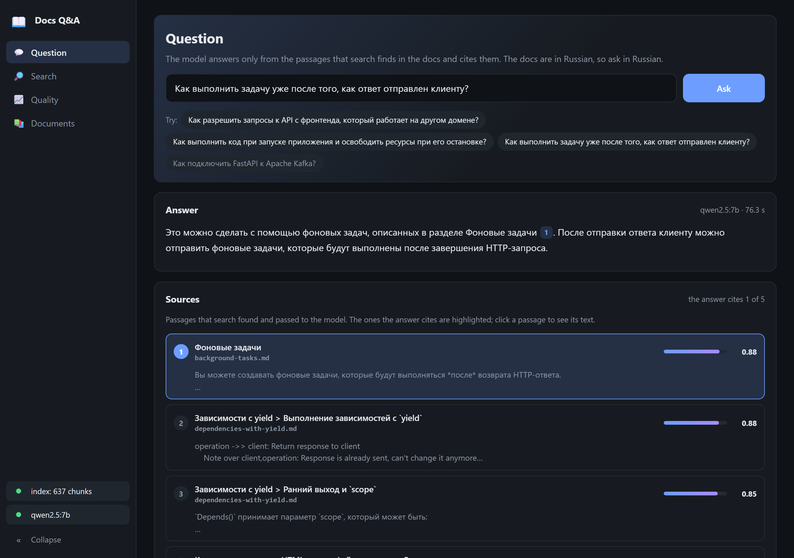
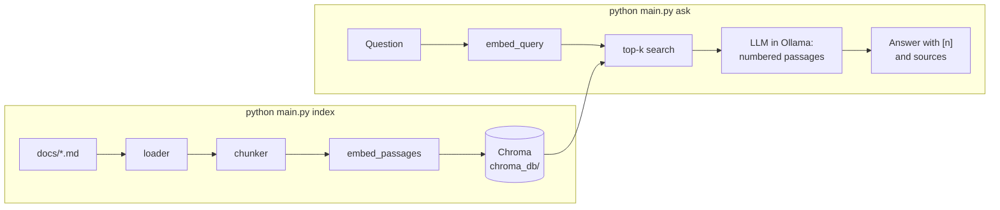
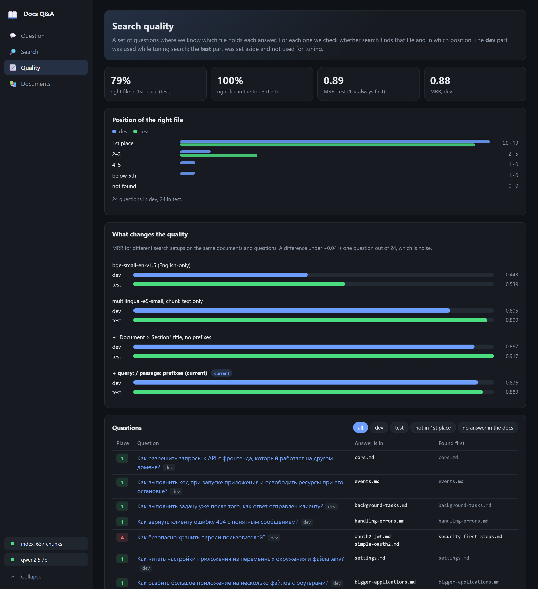

# rag-from-scratch

[](https://github.com/ZhdankovAlex/rag-from-scratch/actions/workflows/tests.yml)

A question-answering assistant over technical documentation, built from scratch:
it reads Markdown files, finds the passages that match a question and has a local
LLM answer from them, with a numbered link to each source. The demo set is
44 pages of the Russian [FastAPI](https://github.com/fastapi/fastapi) documentation
(637 chunks).

**Why the documents, questions and answers are in Russian.** The demo reproduces
a real situation: a company whose internal documentation is written in Russian,
so employees ask in Russian and expect answers in Russian. Everything around the
data — the web UI, the CLI, the code and this README — is in English. The pipeline
itself does not depend on the language: the embedding model (`multilingual-e5-small`)
covers about 100 languages, so the same code works on a folder of English or Serbian
Markdown; only the short system prompt in `rag_system/ollama_chat.py` would be
rewritten for such a team. Russian examples below come with an English translation.

No RAG framework is used: each step (splitting into chunks, embeddings, search,
building the prompt, citations) is written out in the code and can be run on its own.
Everything runs locally and for free: embeddings with `sentence-transformers` on the CPU,
answers from a local LLM through [Ollama](https://ollama.com). Documents are not sent
anywhere. The docs are not built into the code: any folder of Markdown files works.



*The "Question" page. The question: "How do I run a task after the response has
already been sent to the client?" The answer: "This can be done with background
tasks, described in the Background Tasks section [1]. After the response is sent,
you can start background tasks that run once the HTTP request is complete."
The `[1]` marker points to the cited passage of `background-tasks.md`, highlighted
in the "Sources" list below together with the other passages search passed to the model.*

## How it works



| Module | What it does |
|---|---|
| [`rag_system/loader.py`](rag_system/loader.py) | Reads `.md` files from `docs/` recursively. Paths are resolved from the project root, so it does not matter which folder you run it from. |
| [`rag_system/chunker.py`](rag_system/chunker.py) | Splits a document at `##` headings (lines inside code blocks are not treated as headings); each chunk gets a `Document > Section` title, where the document name comes from `#` or `<h1>`. Text before the first `##` becomes its own chunk. The embedding is built from `Document > Section` + text, but only the text is stored and cited. Sections longer than 1000 characters are split further by `RecursiveCharacterTextSplitter` with a 200-character overlap. Chunk IDs are stable: `file::section::part`. |
| [`rag_system/embeddings.py`](rag_system/embeddings.py) | Embeddings from `intfloat/multilingual-e5-small` (384 dimensions, local on the CPU). `query:` / `passage:` prefixes, normalized vectors, batch encoding. |
| [`rag_system/vector_store.py`](rag_system/vector_store.py) | ChromaDB with cosine distance. `sync_chunks()` is incremental: each record stores a fingerprint (model + prefix + title + text), embeddings are computed only for new and changed chunks, records are upserted by ID, and chunks that are gone from the docs are deleted. |
| [`rag_system/index.py`](rag_system/index.py), [`rag_system/retriever.py`](rag_system/retriever.py) | The same search without a database: an in-memory index and top-k with NumPy. Here to show the mechanics and to compare with Chroma. |
| [`rag_system/ollama_chat.py`](rag_system/ollama_chat.py) | Answer generation with a local model through Ollama: passages are sent numbered, the model puts `[n]` after its statements, the markers are parsed and renumbered, and the answer comes back with a list of sources. |
| [`rag_system/answer.py`](rag_system/answer.py) | Answer types (`Answer`, `Source`) and the check for an answer that cites nothing. |
| [`rag_system/evaluate.py`](rag_system/evaluate.py) | Search evaluation: hit@k and MRR on a question set with expected files. |
| [`rag_system/cli.py`](rag_system/cli.py) | CLI: `index`, `search`, `ask`, `chat`, `eval`. Run it as `python main.py …` or `python -m rag_system …`. |
| [`scripts/prepare_corpus.py`](scripts/prepare_corpus.py) | Builds `docs/` from a clone of the FastAPI repository (see "The documents"). |
| [`scripts/compare_embeddings.py`](scripts/compare_embeddings.py) | Compares embedding setups on the question set and writes `eval/experiments.json`. |
| [`web/`](web/) | Local web UI: FastAPI + Jinja2 + plain JS, with a JSON API described in Swagger. |

### How an answer is generated

- The default model is `qwen2.5:7b` in Ollama, `temperature 0.1`, context window
  8192 tokens (by default Ollama silently cuts a long prompt).
- The passages found by search are sent numbered `[1]…[5]`, with file
  and section. The system prompt allows answering only from them and asks
  for the passage number after each statement. The prompt is in Russian,
  like the documents, and tells the model to answer in the language of the question.
- Markers in the answer are renumbered in the order they first appear, `[1, 3]`
  is understood, and made-up numbers (outside the passages that were sent) are dropped.
  The file and section of each source are listed under the answer.
- If the passages do not contain the answer, the model replies with exactly
  «В найденной документации нет ответа на этот вопрос.» ("The documentation found
  has no answer to this question.") and does not fill the gap from general knowledge.
  The code checks for this exact sentence.
- If the answer cites no source (and is not that refusal), the CLI and the web UI
  warn that it may have come from the model's general knowledge.
- If Chinese, Japanese or Korean characters show up in the answer, generation
  stops at once and the user sees "The model went off track… ask the question
  again". Small Qwen models sometimes slide into Chinese on Russian questions
  and then keep writing unrelated text, so there is no point waiting for the end.
  The check is the `DERAILED_SCRIPT` regular expression
  in [`rag_system/ollama_chat.py`](rag_system/ollama_chat.py).

Answer quality is checked by hand for now: on a CPU (16 GB RAM, no GPU)
`qwen2.5:7b` takes about a minute per answer. Automatic answer evaluation is in the
[ROADMAP](ROADMAP.md).

## Quick start

You need Python 3.10+ and [Ollama](https://ollama.com/download).

```bash
ollama pull qwen2.5:7b          # ~4.7 GB; on a weaker machine use qwen2.5:3b (~2 GB)

python -m venv .venv
.venv\Scripts\activate          # Linux/macOS: source .venv/bin/activate
pip install -r requirements.txt

copy .env.example .env          # Linux/macOS: cp .env.example .env

python main.py index            # the first run downloads the embedding model (~470 MB)
python main.py ask "Как разрешить запросы к API с фронтенда на другом домене?"
```

The question means "How do I allow requests to the API from a frontend on another domain?".

Settings in `.env`: `OLLAMA_MODEL` (default `qwen2.5:7b`) and `OLLAMA_URL`
(default `http://localhost:11434`). Models can live outside the system
drive: set the `OLLAMA_MODELS` (Ollama) and `HF_HOME` (embeddings) environment variables.

## Web UI

```bash
python -m web                    # opens http://127.0.0.1:8770/
```



*The "Quality" page: how often search puts the right file first, and in which
position it finds it for each question of the dev and test sets. The questions
in the table are in Russian, like the documents.*

| Page | What it shows |
|---|---|
| **Question** | Ask the model. The answer appears as it is generated and can be stopped. A `[n]` marker in the answer leads to the passage it cites; all passages found by search are listed below. An answer without citations gets a warning. |
| **Search** | Search only, no LLM and no Ollama needed: the closest chunks, their similarity and how long the search took. Useful to see why an answer turned out the way it did. |
| **Quality** | `eval` metrics (hit@k, MRR on dev and test), how the positions are distributed, the comparison of embedding models, and a table of all questions with a filter for misses. |
| **Documents** | What is in the index: documents, the number of chunks and characters in each, and an "Update index" button. |

The bottom of the side panel shows the state of the index and of Ollama (whether it
is running and whether the model is pulled). The server listens on `127.0.0.1` only.
The JSON API is described in Swagger at `http://127.0.0.1:8770/docs`.

## Commands

| Command | What it does | Needs Ollama running |
|---|---|---|
| `python main.py index` | Loads `docs/`, splits it into chunks and syncs Chroma: about 1 minute on a CPU the first time, after that only changes are re-embedded (a fraction of a second when nothing changed) | no |
| `python main.py search "query" [-k N]` | Shows the chunks found and their similarity, to debug search | no |
| `python main.py ask "question" [-k N]` | Answers one question, with sources | yes |
| `python main.py chat [-k N]` | Questions in a loop; an empty line or Ctrl+C exits | yes |
| `python main.py eval [-v] [-s dev\|test]` | Search metrics on the question set, separately for dev and test (see below) | no |

`-k` is how many chunks to retrieve (5 by default).
Each module of the `rag_system/` package can also be run on its own
(`python -m rag_system.retriever`): there is a demo at the bottom of each file.

Example `search` output (chunk text shortened):

```text
> python main.py search "Как разрешить запросы к API с фронтенда на другом домене?" -k 3
1. [0.885] cors.md — CORS (Cross-Origin Resource Sharing) > Шаги
2. [0.881] security-first-steps.md — Безопасность — первые шаги
3. [0.875] security-first-steps.md — Безопасность — первые шаги > «`password` flow» (аутентификация по паролю)
```

The titles are the Russian section names: "CORS > Steps", "Security — first steps",
"Security — first steps > `password` flow (password authentication)".
The CORS page comes first.

## The documents

`docs/` holds 44 pages from `docs/ru/docs` of the
[fastapi/fastapi](https://github.com/fastapi/fastapi) repository (© Sebastián Ramírez,
MIT license, license text in [`docs/LICENSE`](docs/LICENSE)): the tutorial, dependencies,
security, settings, deployment. Only pages with full text were taken, and the files
were renamed into a flat list with unique names.

[`scripts/prepare_corpus.py`](scripts/prepare_corpus.py) rebuilds this set from
a FastAPI clone and removes markup that only means something on the FastAPI site:
heading anchors `{ #… }`, code include directives `{* … *}` (the code examples
live in `docs_src/` and are not part of the set) and `/// tip` block fences.

```bash
git clone --depth 1 --filter=blob:none --sparse https://github.com/fastapi/fastapi.git
git -C fastapi sparse-checkout set docs/ru
python scripts/prepare_corpus.py fastapi
```

## Tests

```bash
pip install -r requirements-dev.txt
python -m pytest
ruff check .                     # linter, rules in pyproject.toml
```

The tests run offline and take seconds: the embedding model is replaced by
deterministic vectors (the fixture fails if a test tries to load the real one),
Chroma writes to a temporary folder, and LLM answers are replaced by prepared ones.
Covered: chunking, store sync (repeat run, update, delete, batches, incremental
updates), prompt building and `[n]` marker parsing, Ollama errors,
the CLI (calling Ollama, the warning for answers without sources), the web API
(search, answer, Ollama errors), `eval` metrics, and that the question set
matches the documents.

The linter and the tests run on every push in GitHub Actions
([`.github/workflows/tests.yml`](.github/workflows/tests.yml)), with the CPU build
of torch and Hugging Face in offline mode, so an accidental model download fails the run.

## Search quality

```bash
python main.py eval            # summary for dev and test
python main.py eval -v -s test # every question of the test set
```

The set [`eval/retrieval_questions.json`](eval/retrieval_questions.json) has 54 questions
in Russian, written the way a user would ask them (not copies of headings). Each one
lists the files whose text contains the answer; a hit is counted by the file of the
first relevant chunk. Metrics: **hit@k** is the share of questions where the right file
is in the top k; **MRR** is the mean reciprocal rank of the first hit (search depth 20).

- **dev** (24 questions): search setups are compared on these, so their numbers
  are optimistic.
- **test** (24 questions; each of the 44 documents is covered by dev or test): set aside,
  not used to choose settings.
- **negative** (6 questions in test: Kafka, Prometheus, gRPC, Stripe…): the documents
  have no answer, checked with a text search. They are not part of the search metrics;
  they are there to check that the model refuses to answer.

| Set | hit@1 | hit@3 | hit@5 | MRR |
|---|---|---|---|---|
| dev | 83% | 92% | 96% | 0.876 |
| test | 79% | **100%** | **100%** | 0.889 |

The right document is almost always in the top 3. When it is not first, the first
result is a neighbouring page on the same topic: «Как получить имя пользователя
и пароль из формы при выдаче токена?» ("How do I get the username and password
from the form when issuing a token?") finds `security-first-steps.md` first,
while the answer is explained in detail in `simple-oauth2.md`.

### What changes the quality

Setups compared on these documents (same chunks, in-memory search; reproduce with
`python scripts/compare_embeddings.py`, about 4 minutes on a CPU):

| Setup | dev hit@1 | dev MRR | test hit@1 | test MRR |
|---|---|---|---|---|
| `BAAI/bge-small-en-v1.5` (English-only model) | 29% | 0.443 | 46% | 0.539 |
| `multilingual-e5-small`, chunk text only | 71% | 0.805 | 83% | 0.899 |
| + `Document > Section` title in the embedded text, no E5 prefixes | 79% | 0.867 | 83% | **0.917** |
| + `query:` / `passage:` prefixes (current) | **83%** | **0.876** | 79% | 0.889 |

- **The embedding model** matters most: a multilingual model of the same size
  is twice as accurate as the English-only one on Russian documents.
- **The title in the embedding** raises dev (MRR +0.06): parts of a long section
  and introductory paragraphs do not mention the topic until the title is added.
  On test the difference is within one question.
- **E5 prefixes** also move the numbers by one question out of 24 either way; they
  are kept because the model was trained with them.

With 24 questions, one question is 4 percentage points of hit@1 and up to 0.04 MRR,
so smaller differences are noise.

**Tried and not adopted (on a different, private document set of the same size):**
hybrid search, BM25 + vectors with Reciprocal Rank Fusion (four ways of tokenizing
Russian, including Snowball), and a cross-encoder reranker over the vector top 20
(multilingual MiniLM and a Russian model). None gave a stable improvement, and the
reranker added 2–6 s per question on a CPU. They have not been re-measured on these
documents; see the [ROADMAP](ROADMAP.md).

## Limitations and next steps

- Only search is evaluated automatically; LLM answers are checked by hand.
- The guard against a model going off track treats any Chinese, Japanese
  or Korean character in the answer as an error. If your documents contain them
  and the model quotes them, the answer will be cut off: remove or narrow
  `DERAILED_SCRIPT` in `rag_system/ollama_chat.py`.
- FastAPI code examples are not in the set (the site includes them from separate
  files), so "show me the code" questions are matched by the description only.

The plan is in [ROADMAP.md](ROADMAP.md).
